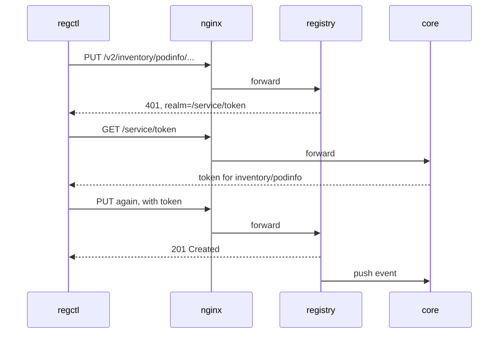

# Following A Push Through Harbor

A push looks like one command, but inside Harbor it is a short conversation between three components. If any one of them is missing, the push fails, and the error tells you where it stopped, if you know the order. This part creates a project, pushes an image into it, follows the requests through Harbor, and then shows the health API that reports each component's state.

## A project to push into

Every repository in Harbor lives in a **project**: Harbor's unit of access control and quota. You cannot push to a project that does not exist, so create one first. The Harbor REST API v2.0 is the HTTP API that the portal and every client use, and it accepts a JSON body for a new project.

<!-- astrona:playground:renew -->

Create the private project `inventory` as the administrator (lab-only password):

```sh
ws() { kubectl -n workstation exec -i deploy/workstation -- "$@"; }
ws curl -sS -u admin:Harbor12345 -X POST -H 'Content-Type: application/json' \
  -d '{"project_name":"inventory","metadata":{"public":"false"}}' \
  https://harbor.localtest.me:8443/api/v2.0/projects
ws curl -sS -u admin:Harbor12345 'https://harbor.localtest.me:8443/api/v2.0/projects?name=inventory' | ws jq '.[0] | {name, project_id}'
```

The first request returns no body when it succeeds; Harbor answers with the status `201 Created`. The second request reads the project back and shows its name and numeric ID. `core` handled both requests and stored the project in `database`.

## Push an image and watch the order

`regctl` is a command-line client for OCI registries. It can copy an image from one registry to another without a container engine, which is why the workstation uses it. Sign in, then copy the podinfo image from the GitHub registry into the new project:

```sh
ws regctl registry login harbor.localtest.me:8443 -u admin -p Harbor12345
ws regctl image copy ghcr.io/stefanprodan/podinfo:6.15.0 harbor.localtest.me:8443/inventory/podinfo:6.15.0
```

The copy takes a few seconds and prints nothing when it succeeds. Behind it, the requests went through Harbor in this order:



The diagram shows the token handshake: the registry refuses the first request and names the token service, `core` checks the user and the project and signs a token, and the registry accepts the request that carries the token. After the push, the registry tells `core` about it, so the artifact appears in the portal and the API.

The first refusal is visible. Ask the registry for its API root without a token and look at the header it returns:

```sh
ws curl -sSI https://harbor.localtest.me:8443/v2/
```

The status is `401 Unauthorized`, and the `WWW-Authenticate` header names the realm `https://harbor.localtest.me:8443/service/token`. That realm is built from Harbor's external URL setting. If that setting is wrong, every client goes to the wrong address for its token, and every push fails at this step.

## Ask Harbor how it is

Harbor reports the state of each component at `/api/v2.0/health`. `core` builds the report by checking every other component, so one request tells you which part is down. Read it:

```sh
ws curl -sS https://harbor.localtest.me:8443/api/v2.0/health | ws jq
```

The JSON has an overall `status` and a list of `components`, each with a `name` and a `status`. On a working Harbor every status is `healthy`, and the names include `core`, `database`, `jobservice`, `portal`, `redis`, `registry`, `registryctl` and `trivy`. An unhealthy component also carries an `error` field with the reason `core` saw.

A second endpoint describes the installation itself:

```sh
ws curl -sS -u admin:Harbor12345 https://harbor.localtest.me:8443/api/v2.0/systeminfo | ws jq '{harbor_version, external_url, auth_mode}'
```

It shows the Harbor version, the external URL clients must use, and the authentication mode (`db_auth` here: users are stored in Harbor's own database). When a push fails, these two requests are the quickest first look.

Now break one component on purpose and see the report change. Stop the registry, read the health report, and start it again:

```sh
kubectl -n harbor scale deployment/harbor-registry --replicas=0
ws curl -sS https://harbor.localtest.me:8443/api/v2.0/health | ws jq -r '.components[] | "\(.name) \(.status)"'
kubectl -n harbor scale deployment/harbor-registry --replicas=1
kubectl -n harbor rollout status deployment/harbor-registry
```

While the registry is stopped, `registry` and `registryctl` show `unhealthy`, and a push fails, while the API and the portal keep working. That split is the reason the health API is the first thing to read: the portal can look fine while Harbor cannot store anything.

You can now follow a push through `nginx`, `registry` and the token service in `core`, and read which component is down. The open question is what else Harbor can store besides images, and how you prove two copies are the same.

## Common pitfalls

> [!WARNING]
> - **Reading only the overall status.** `status: unhealthy` says something is wrong, not what. Read the `components` list.
> - **Restarting everything.** A stopped component is brought back with `kubectl scale` or `kubectl rollout restart` for that one workload. Reinstalling Harbor loses every artifact in this lab environment, because nothing is persisted.
> - **Pushing to a project that does not exist.** Harbor does not create projects on push; create the project first.
> - **Trusting the portal.** The web portal can load while `registry` or `jobservice` is down.

## Your mission: Find And Restart The Broken Harbor Components

You can now read Harbor's health report and bring a stopped component back. The graded lab gives you a Harbor that refuses pushes, and asks you to find the stopped components and start them without reinstalling Harbor.

The lab runs in its own cluster, so first pause your playground. Nothing in it is lost:

```sh
astrona stop ats-100-playground-010-01
```

Then start the lab:

```sh
astrona run --git ssh://git@github.com/astrona-io/ATS100.git -c sections/section-010/module-01/labs/lab-01
```

The task is on the next page. Solve it on your own first. When you think you are done, send it for grading:

```sh
astrona submit -c sections/section-010/module-01/labs/lab-01
```

When the lab is done, remove it and start your playground again:

```sh
astrona destroy ats-100-lab-010-01
astrona start ats-100-playground-010-01
```
